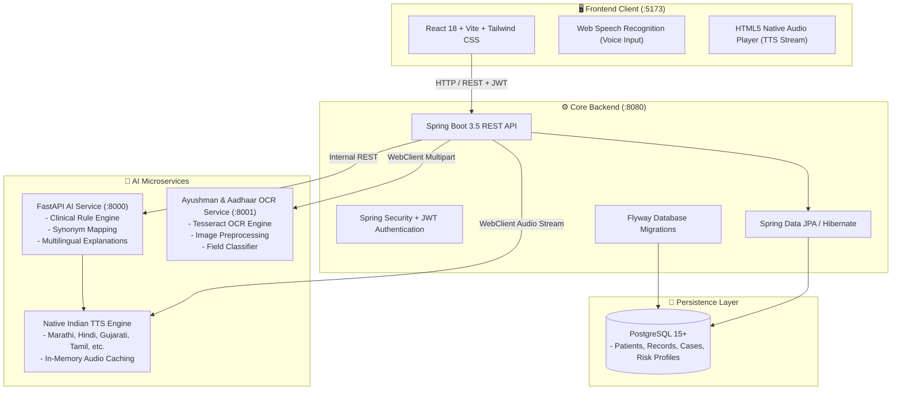
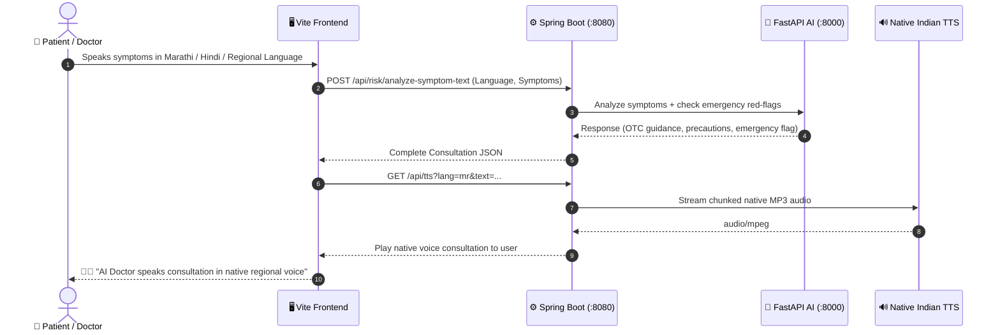
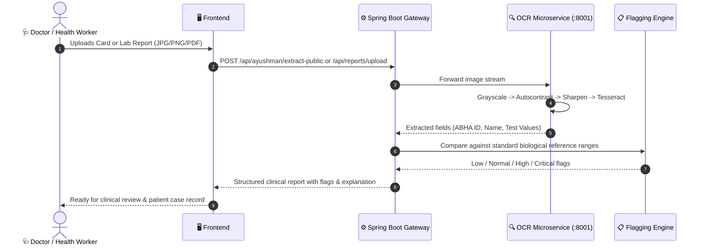

# MediCase-AI 🏥
### AI-Powered Multilingual Healthcare & Clinical Intelligence Platform

[](https://react.dev/)
[](https://spring.io/projects/spring-boot)
[](https://fastapi.tiangolo.com/)
[](https://www.postgresql.org/)
[](https://github.com/tesseract-ocr/tesseract)
[]()
[](LICENSE)

---

## 📌 Overview

**MediCase-AI** is a modern, full-stack healthcare intelligence system engineered to assist general practitioners, AYUSH practitioners, and patients across India. It bridges medical comprehension and language barriers by providing:

1. **Intelligent Lab Report OCR & Value Extraction** (CBC, Lipid, Renal, Liver panels with rule-based flagging).
2. **Ayushman Bharat & Aadhaar Card Auto-Scanning** (Frictionless patient onboarding via computer vision).
3. **Multilingual AI Doctor Voice Consultation** (Voice and text symptom intake with authentic native audio responses across 12 Indian languages).
4. **Early Health Risk Stratification** (Type-2 Diabetes, Hypertension, and Cardiovascular risk assessments).
5. **Real-Time Emergency Triaging** (Immediate auditory and visual critical warnings for high-risk symptoms).

> ⚠️ **Clinical Safety Notice**: MediCase-AI provides preliminary decision support and educational guidance. It is **not** a replacement for clinical diagnosis by licensed medical practitioners.

---

## 🏗️ System Architecture



---

## 🔄 End-to-End User Workflows

### 1. Patient Consultation & Multilingual Voice Flow


### 2. Lab Report & Card OCR Extraction Flow


---

## ✨ Core Features

### 1. 👨‍⚕️ Multilingual AI Doctor Voice Consultation
- **12 Supported Languages**:
  - `hi` — हिंदी (Hindi)
  - `mr` — मराठी (Marathi)
  - `gu` — ગુજરાતી (Gujarati)
  - `bn` — বাংলা (Bengali)
  - `ta` — தமிழ் (Tamil)
  - `te` — తెలుగు (Telugu)
  - `kn` — ಕನ್ನಡ (Kannada)
  - `ml` — മലയാളം (Malayalam)
  - `pa` — ਪੰਜਾਬੀ (Punjabi)
  - `ur` — اردو (Urdu)
  - `en` — English
  - `or` — ଓଡ଼ିଆ (Odia)
- **High-Fidelity Audio Streaming**: Server-side chunked MP3 audio generation using native pronunciation.
- **Natural Playback Controls**: Calm pace (0.85x), Normal (0.92x), Standard (1.0x) with Play / Pause / Resume / Stop capabilities.
- **Smart Fallback**: Seamless fallback to Web Speech API if offline.

### 2. 🚨 Critical Emergency Detection & Alarm
- Real-time screening for acute symptoms (e.g. chest pain, radiating left arm pain, severe breathlessness, hemoptysis).
- Visual pulsing red alert banner + loud auditory alert spoken in the patient's native tongue.
- Immediate 108 Emergency ambulance advice.

### 3. 📄 Automated Lab Report Processing
- Supports CBC, Lipid Panel, Diabetic Panels (HbA1c, Fasting Glucose), Renal Function (Creatinine, Urea), and Liver Function.
- Strict rule-based flagging prevents hallucinated reference ranges.
- Safe, non-prescriptive, jargon-free explanations in simple Hindi, Marathi, or English.

### 4. 💳 Ayushman Bharat & Aadhaar Verification Assistance
- Automatic field extraction: PM-JAY Card ID, ABHA Number, Beneficiary Name, Gender, DOB, and masked Aadhaar format.
- Pre-populates registration forms in 1 click, eliminating manual typing errors in rural/semi-urban clinics.

---

## 📂 Repository Structure

```
AI_HEALTH_CARE-main/
├── frontend/                        # React 18 + Vite frontend
│   ├── src/
│   │   ├── components/              # SymptomVoiceAnalyzer, Navbar, Sidebar
│   │   ├── pages/                   # HealthRiskAssessment, AyushmanScanner, AadhaarScanner
│   │   ├── services/                # Axios API services (riskService, authService, etc.)
│   │   └── index.css                # Tailwind CSS design system
│   ├── package.json
│   └── vite.config.js
├── backend-java/                    # Core Spring Boot backend
│   ├── src/main/java/com/medicase/
│   │   ├── client/                  # AiServiceClient, AyushmanOcrClient
│   │   ├── controller/              # Auth, Case, Patient, Risk, Tts, Ayushman, Aadhaar
│   │   ├── entity/                  # JPA Models (User, Patient, MedicalReport, Case)
│   │   ├── repository/              # Spring Data JPA repositories
│   │   └── security/                # JWT Filter & SecurityConfig
│   ├── src/main/resources/          # application.yml, Flyway migrations
│   └── pom.xml
├── backend-python/                  # FastAPI AI & Clinical Intelligence Service
│   ├── app/
│   │   ├── api/                     # health, report, risk, summary, translation, tts
│   │   ├── core/                    # config, knowledge base (synonyms, prompts)
│   │   ├── schemas/                 # Pydantic validation models
│   │   └── services/                # extraction_service, flag_engine, risk_engine
│   ├── requirements.txt
│   └── run.py
├── ayushman_login_system/           # Dedicated Card OCR Service
│   ├── app.py                       # Preprocessing & Tesseract OCR pipeline
│   ├── models/                      # ML field classifier
│   └── run.py
├── database/                        # PostgreSQL local data directory
├── start-all.bat                    # Windows 1-click startup script for all 5 services
├── stop-all.bat                     # Windows 1-click shutdown script
├── docker-compose.yml               # Production container deployment
└── README.md
```

---

## ⚡ Getting Started

### Prerequisites

| Tool | Recommended Version |
|------|--------------------|
| **Java JDK** | 17 or 21+ |
| **Python** | 3.10, 3.11, or 3.12 |
| **Node.js** | 18+ and npm |
| **PostgreSQL** | 15+ |
| **Tesseract OCR** | 5.0+ with Hindi/Devanagari traineddata |

---

### Option A: One-Click Launch (Windows)

All five services (PostgreSQL, FastAPI AI, Ayushman OCR, Spring Boot Backend, Vite Frontend) can be started together with a single script:

```bat
start-all.bat
```

To gracefully shut down all background services:
```bat
stop-all.bat
```

---

### Option B: Manual Step-by-Step Setup

#### 1. Setup PostgreSQL Database
```sql
CREATE DATABASE medicase;
CREATE USER medicase WITH PASSWORD 'change-me';
GRANT ALL PRIVILEGES ON DATABASE medicase TO medicase;
```

#### 2. Start the FastAPI AI Service (Port 8000)
```bash
cd backend-python
python -m venv .venv
# Windows: .venv\Scripts\activate | Linux: source .venv/bin/activate
pip install -r requirements.txt
python run.py
```
*Health Check: `http://localhost:8000/health`*

#### 3. Start the Ayushman OCR Service (Port 8001)
```bash
cd ayushman_login_system
python -m venv .venv
# Windows: .venv\Scripts\activate | Linux: source .venv/bin/activate
pip install -r requirements.txt
python run.py
```
*Health Check: `http://127.0.0.1:8001/health`*

#### 4. Start the Spring Boot Backend (Port 8080)
```bash
cd backend-java
./mvnw spring-boot:run -Dspring-boot.run.profiles=dev
# On Windows: .\mvnw.cmd spring-boot:run -Dspring-boot.run.profiles=dev
```
*Health Check: `http://localhost:8080/actuator/health`*

#### 5. Start the Vite Frontend (Port 5173)
```bash
cd frontend
npm install
npm run dev
```
*Access Application: `http://localhost:5173`*

---

### Option C: Run with Docker Compose

```bash
cp .env.example .env
docker compose up --build
```

---

## 🌐 Port & Service Mapping

| Service | Port | Endpoint URL | Description |
|---------|------|--------------|-------------|
| **Frontend UI** | `5173` | `http://localhost:5173` | Vite + React Web Application |
| **Spring Boot Backend** | `8080` | `http://localhost:8080/api` | Central Authentication & Gateway API |
| **AI Intelligence Service** | `8000` | `http://localhost:8000` | Lab analysis, risk engine & TTS streaming |
| **Card OCR Service** | `8001` | `http://127.0.0.1:8001` | Tesseract Ayushman/Aadhaar image parser |
| **PostgreSQL Database** | `5432` | `localhost:5432` | Relational clinical database |

---

## 🔒 Security & Data Privacy

- **Stateless JWT Authentication**: Passwords hashed using standard `BCryptPasswordEncoder`.
- **Role-Based Access Control (RBAC)**: Distinct permissions for `DOCTOR`, `PATIENT`, `ADMIN`, and `RESEARCHER`.
- **Internal Service Isolation**: Direct access to AI microservices is guarded by cryptographic `X-API-KEY` checks.
- **Patient Privacy**: PII and Aadhaar numbers are masked; raw biometric data is never stored.

---

## 🤝 Contributing

Contributions are welcome! Please open an issue or submit a pull request:
1. Fork the Project
2. Create your Feature Branch (`git checkout -b feature/AmazingFeature`)
3. Commit your Changes (`git commit -m 'Add some AmazingFeature'`)
4. Push to the Branch (`git push origin feature/AmazingFeature`)
5. Open a Pull Request

---

## 📄 License

Distributed under the MIT License. See `LICENSE` for more information.
